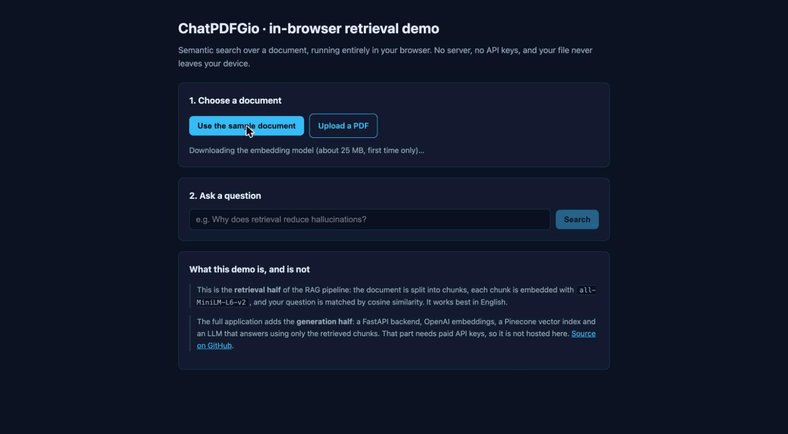

# ChatPDFGio — chatea con tus documentos (RAG full-stack)

[English](README.md) · **Español**

Aplicación **RAG (Retrieval-Augmented Generation)** de extremo a extremo: sube PDF, Word, presentaciones o audio y pregunta en lenguaje natural. Las respuestas se construyen con el contenido de tus documentos y vuelven **con las páginas de donde salieron**.

[](https://github.com/Giocrisrai/chatpdfgio/actions/workflows/ci.yml)
[](https://www.python.org/)
[](https://fastapi.tiangolo.com/)
[](https://platform.openai.com/)
[](https://www.pinecone.io/)
[](https://streamlit.io/)
[](LICENSE.md)

**[▶ Demo en vivo](https://giocrisrai.github.io/chatpdfgio/)** — la mitad de recuperación del pipeline, corriendo entera en tu navegador.



---

## Qué hace

- **Ingesta** PDF, DOCX, PPTX, TXT y Markdown, y MP3/M4A/WAV mediante transcripción.
- **Fragmenta página por página**, así cada fragmento sabe de qué página o diapositiva viene.
- **Responde con fuentes**: cada respuesta lista el archivo y la página de los pasajes que recibió el modelo.
- **Funciona sin ninguna cuenta.** Sin claves arranca con un backend local, para probar el flujo completo y correr las pruebas sin conexión.

## Cómo funciona

```
archivo ─► extracción de texto ─► fragmentación ─► embeddings ─► índice vectorial
           (pypdf, docx, pptx)     (por página)     (OpenAI)      (Pinecone)
                                                                     │
pregunta ─► embedding ─► búsqueda por similitud ◄────────────────────┘
                                │
                                ▼
            pasajes recuperados ─► LLM (OpenAI) ─► respuesta fundamentada + fuentes
```

Al modelo se le indica responder **solo** con los pasajes recuperados y tratarlos como datos: un texto dentro de un documento que parezca una instrucción no se obedece (inyección indirecta de prompts).

## Dos backends

| | `local` (por defecto sin claves) | `cloud` |
|---|---|---|
| Embeddings | Bolsa de palabras con hashing (léxico) | OpenAI `text-embedding-3-small` |
| Índice vectorial | En memoria | Pinecone serverless |
| Respuesta | Los mejores pasajes, textuales | Modelo de OpenAI por la Responses API |
| Audio | No soportado | Transcrito con OpenAI |
| Necesita | Nada | `OPENAI_API_KEY` y `PINECONE_API_KEY` |

El backend local es léxico, no semántico, y no genera texto. Sirve para ejecutar, mostrar y probar el pipeline; el backend de nube es el real.

## Inicio rápido

### Docker

```bash
git clone https://github.com/Giocrisrai/chatpdfgio.git && cd chatpdfgio
cp .env.example .env          # déjalo vacío para usar el backend local
docker compose up --build
```

- API y documentación interactiva: http://localhost:8000/docs
- Cliente Streamlit: http://localhost:8501 (el inicio de sesión necesita credenciales de Firebase)

### Solo la API

```bash
cd api
python -m venv .venv && source .venv/bin/activate
pip install -r requirements-dev.txt
uvicorn main:app --reload
```

```bash
curl -X POST localhost:8000/multipleupload/ -F "files=@contrato.pdf"
curl -X POST --get localhost:8000/chat/ --data-urlencode "query=¿Cuál es la multa por atraso?"
```

## API

| Método | Ruta | Para qué |
|---|---|---|
| `GET` | `/health` | Estado y backend activo |
| `GET` | `/check-documents/` | Si hay algún documento indexado |
| `POST` | `/upload/` | Ingestar un archivo |
| `POST` | `/multipleupload/` | Ingestar varios; un resultado por archivo |
| `POST` | `/chat/?query=…` | Responder una pregunta; devuelve `response` y `sources` |

## Configuración

Todo se define con variables de entorno; ver [`.env.example`](.env.example). Las principales: `RAG_BACKEND`, `OPENAI_API_KEY`, `PINECONE_API_KEY`, `CHAT_MODEL` (por defecto `gpt-5-mini`), `EMBEDDING_MODEL`, `PINECONE_INDEX`, `S3_BUCKET`, `CORS_ORIGINS` y `MAX_UPLOAD_MB`. La tabla completa está en el [README en inglés](README.md#configuration).

## Pruebas

```bash
cd api && pytest tests -q        # 34 pruebas, menos de dos segundos
```

- El pipeline y la API HTTP se prueban de punta a punta con el backend local, con archivos PDF, DOCX y PPTX reales construidos en las propias pruebas.
- Los adaptadores de OpenAI y Pinecone se prueban contra clientes simulados que fijan las llamadas que hacen. **No se ejecutan contra los servicios reales en el CI**, porque harían falta claves de pago.

## Estado

La versión 2 es una reescritura de un proyecto de 2023: SDK actuales de OpenAI y Pinecone, sin efectos al importar, fuentes en cada respuesta, un backend que corre sin conexión, pruebas y CI. El cliente Streamlit conserva su inicio de sesión original con Firebase.

## Autor

[Giocrisrai Godoy Bonillo](https://giocrisrai.com) — AI Engineer · contact@giocrisrai.com

## Licencia

MIT — ver [`LICENSE.md`](LICENSE.md).
