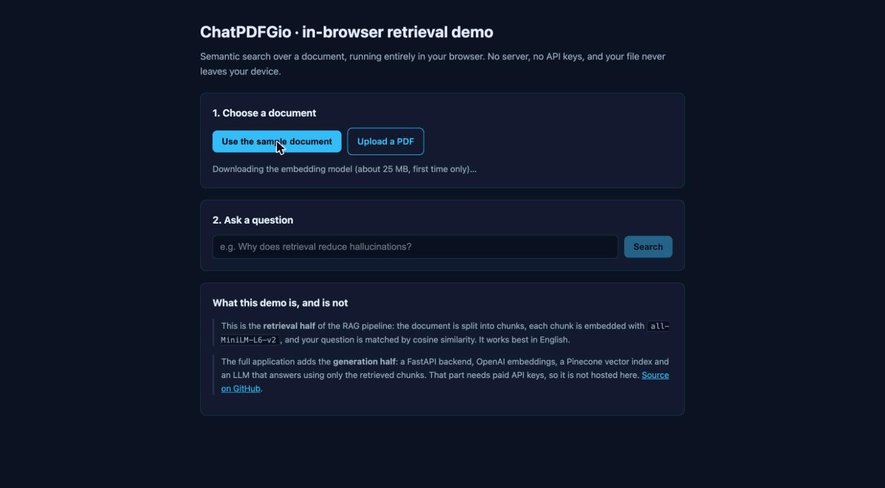

# ChatPDFGio — chat with your documents (full-stack RAG)

**English** · [Español](README.es.md)

An end-to-end **RAG (Retrieval-Augmented Generation)** application: upload PDFs, Word files, slides or audio and ask questions in natural language. Answers are built from the content of your documents and come back **with the pages they were taken from**.

[](https://github.com/Giocrisrai/chatpdfgio/actions/workflows/ci.yml)
[](https://www.python.org/)
[](https://fastapi.tiangolo.com/)
[](https://platform.openai.com/)
[](https://www.pinecone.io/)
[](https://streamlit.io/)
[](LICENSE.md)

**[▶ Live demo](https://giocrisrai.github.io/chatpdfgio/)** — the retrieval half of the pipeline, running entirely in your browser.



---

## What it does

- **Ingests** PDF, DOCX, PPTX, TXT and Markdown, plus MP3/M4A/WAV through transcription.
- **Chunks page by page**, so every chunk knows the page or slide it came from.
- **Answers with sources**: each answer lists the file and page of the passages the model was given.
- **Runs without any account.** With no API keys it starts on a local backend, so you can try the whole flow and run the tests offline.

## How it works

```
file ─► text extraction ─► chunking ─► embeddings ─► vector index
        (pypdf, docx, pptx)  (per page)   (OpenAI)      (Pinecone)
                                                           │
question ─► embedding ─► similarity search ◄───────────────┘
                              │
                              ▼
             retrieved passages ─► LLM (OpenAI) ─► grounded answer + sources
```

The model is told to answer **only** from the retrieved passages, and to treat them as data: text inside a document that looks like an instruction is not followed (indirect prompt injection).

## Two backends

| | `local` (default without keys) | `cloud` |
|---|---|---|
| Embeddings | Hashing bag-of-words (lexical) | OpenAI `text-embedding-3-small` |
| Vector index | In memory | Pinecone serverless |
| Answer | The best passages, verbatim | OpenAI model through the Responses API |
| Audio | Not supported | Transcribed with OpenAI |
| Needs | Nothing | `OPENAI_API_KEY` and `PINECONE_API_KEY` |

The local backend is lexical, not semantic, and does not generate text. It exists to run, demo and test the pipeline; the cloud backend is the real thing.

## Quick start

### Docker

```bash
git clone https://github.com/Giocrisrai/chatpdfgio.git && cd chatpdfgio
cp .env.example .env          # leave it empty to use the local backend
docker compose up --build
```

- API and interactive docs: http://localhost:8000/docs
- Streamlit client: http://localhost:8501 (sign-in needs Firebase credentials)

### API only

```bash
cd api
python -m venv .venv && source .venv/bin/activate
pip install -r requirements-dev.txt
uvicorn main:app --reload
```

```bash
curl -X POST localhost:8000/multipleupload/ -F "files=@contract.pdf"
curl -X POST --get localhost:8000/chat/ --data-urlencode "query=What is the late payment penalty?"
```

## API

| Method | Path | Purpose |
|---|---|---|
| `GET` | `/health` | Liveness and active backend |
| `GET` | `/check-documents/` | Whether any document has been indexed |
| `POST` | `/upload/` | Ingest one file |
| `POST` | `/multipleupload/` | Ingest several files; one result per file |
| `POST` | `/chat/?query=…` | Answer a question; returns `response` and `sources` |

## Configuration

Everything is set with environment variables; see [`.env.example`](.env.example).

| Variable | Default | Notes |
|---|---|---|
| `RAG_BACKEND` | `cloud` if both keys are set, else `local` | |
| `OPENAI_API_KEY`, `PINECONE_API_KEY` | — | Enable the cloud backend |
| `CHAT_MODEL` | `gpt-5-mini` | Any model your account can use |
| `EMBEDDING_MODEL` / `EMBEDDING_DIMENSIONS` | `text-embedding-3-small` / `1536` | The index is created with these dimensions |
| `PINECONE_INDEX`, `PINECONE_CLOUD`, `PINECONE_REGION` | `chatpdfgio`, `aws`, `us-east-1` | Created on first use if missing |
| `S3_BUCKET` | — | Keep the original files in S3 instead of a local folder |
| `CORS_ORIGINS` | `http://localhost:8501` | Comma-separated |
| `MAX_UPLOAD_MB` | `25` | |

## Project layout

```
api/
  main.py            FastAPI app (application factory, no side effects at import)
  app/
    config.py        settings from the environment
    extraction.py    file → text, per page / slide
    chunking.py      overlapping chunks that never span two pages
    embeddings.py    OpenAI and hashing embedders
    vector_store.py  Pinecone and in-memory indexes
    generation.py    grounded prompt, OpenAI and extractive generators
    storage.py       local folder or S3
    rag.py           the pipeline: ingest and answer
    services.py      wires the backend; the only place clients are created
  tests/             34 tests, no network, no keys
streamlit_app/       web client
demo/                in-browser retrieval demo (GitHub Pages)
```

## Tests

```bash
cd api && pytest tests -q        # 34 tests, under two seconds
```

- The pipeline and the HTTP API are tested end to end on the local backend, with real PDF, DOCX and PPTX files built in the tests.
- The OpenAI and Pinecone adapters are tested against stand-in clients that pin the calls they make. **They are not run against the real services in CI**, which would need paid keys.

## Status

Version 2 is a rewrite of a 2023 project: current OpenAI and Pinecone SDKs, no import-time side effects, sources in every answer, a backend that runs offline, tests and CI. The Streamlit client keeps its original Firebase sign-in.

## Author

[Giocrisrai Godoy Bonillo](https://giocrisrai.com) — AI Engineer · contact@giocrisrai.com

## License

MIT — see [`LICENSE.md`](LICENSE.md).
